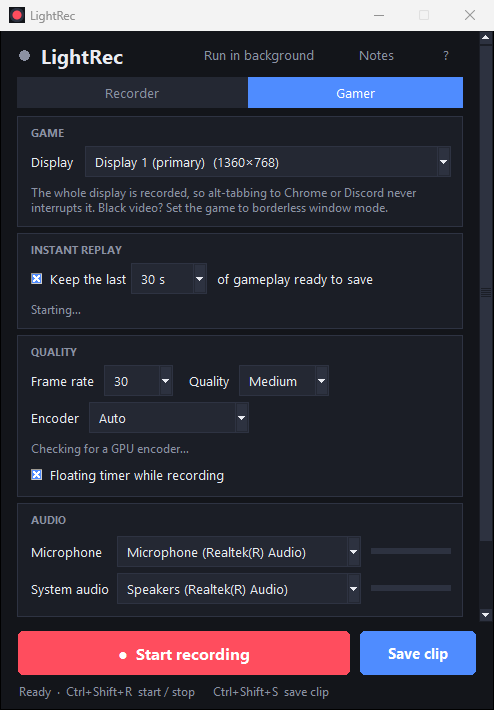
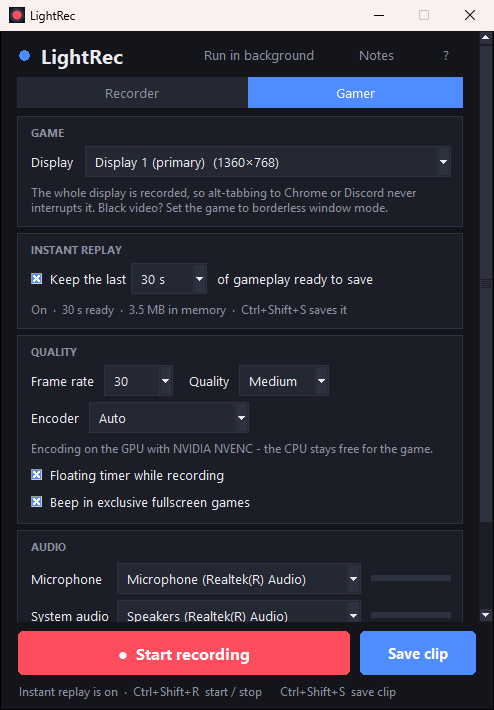

<p align="center">
  
</p>

<h1 align="center">LightRec</h1>

<p align="center">
  <b>The screen recorder that stays out of your way.</b><br>
  One small window. No install, no account, no watermark, no upload.<br>
  And a <b>Gamer mode</b> that does what Game Bar should have done.
</p>

<p align="center">
  <a href="https://github.com/Hodaifa98/LightRec/releases/latest"></a>
  
  
  <a href="LICENSE"></a>
</p>

<p align="center">
  <a href="https://github.com/Hodaifa98/LightRec/releases/latest/download/LightRec-windows-x64.zip"><b>⬇ Download for Windows</b></a>
  &nbsp;&nbsp;·&nbsp;&nbsp;
  <a href="https://github.com/Hodaifa98/LightRec/releases/latest/download/LightRec-linux-x64.tar.gz"><b>⬇ Download for Linux</b></a>
  &nbsp;&nbsp;·&nbsp;&nbsp;
  <a href="https://hodaifa98.github.io/HApps/lightrec/">Website</a>
</p>

<p align="center">
  Portable builds with ffmpeg inside. Unzip, double-click, record. That's the whole setup.
</p>

---

<table>
<tr>
<td width="33%" valign="top">
<h3>🎯 Point and record</h3>
Full screen, an area you drag out, or one window. Mic and system audio with live meters. Pause, countdown, a floating control bar, global shortcuts. Standard H.264 <code>.mp4</code> that plays everywhere.
</td>
<td width="33%" valign="top">
<h3>🎮 Gamer mode</h3>
Instant replay keeps the last 15 s to 2 min of gameplay ready; one key saves it. Record whole sessions for hours on the GPU. Alt-tab to Chrome mid-match and nothing breaks. Lives in the tray.
</td>
<td width="33%" valign="top">
<h3>🔒 Yours only</h3>
Nothing leaves your PC. No account, no telemetry, no cloud, no watermark, no time limit. Hide windows from the recording, keep your notes on screen without recording them.
</td>
</tr>
</table>

<p align="center">
  
  &nbsp;
  
</p>

## Gamer mode: the Game Bar replacement

If you've ever lost a clip because Game Bar "stopped recording" the moment you tabbed out, this is
for you. Gamer mode records the whole display, not a window, so **switching to Chrome or Discord in
the middle of a match changes nothing**.

- **Instant replay.** Tick *Keep the last 30 s of gameplay ready to save* and play. When something
  happens, press `Ctrl+Shift+S` and the clip lands in your folder as a `.mp4`, with a small notice in
  the corner confirming it. Nothing can be drawn over a game in exclusive fullscreen, so there a quiet
  beep confirms it instead (you can turn it off). Each save empties the buffer, so pressing again five
  seconds later gives you a five-second clip, not the same thirty seconds twice. Choose 15 s, 30 s,
  1 min or 2 min.
- **Long sessions.** `Ctrl+Shift+R` records for as long as you like. Instant replay keeps working
  while a session records, both fed by one capture.
- **GPU encoding.** LightRec test-encodes with NVIDIA NVENC, AMD AMF and Intel Quick Sync on first
  start and uses the first that works, so the CPU stays free for the game. x264 is the fallback.
- **Run in background.** Press *Run in background* (or close the window while replay is on) and
  LightRec tucks itself into the tray next to the clock. Blue icon: replay ready. Red: recording.
  Right-click for *Save the last 30 s*, *Start / Stop recording*, *Open* and *Quit*.
- **Start it before you play.** `LightRec.exe --tray` starts straight in the tray with gamer mode
  on. Put a shortcut to it in your Startup folder (`Win+R`, `shell:startup`) and instant replay is
  simply always there.
- **Black video?** Games in *exclusive fullscreen* bypass the desktop and can't be captured this
  way. Switch the game to *borderless window* (most default to it nowadays); LightRec tells you in
  the status line when the capture stays black.

| Shortcut | Does |
| --- | --- |
| `Ctrl+Shift+R` | Start / stop recording |
| `Ctrl+Shift+S` | Save the last seconds (only registered while instant replay is on, so it stays "Save as" everywhere else the rest of the time) |
| `Ctrl+Shift+P` | Pause / resume (Recorder mode) |

## Recorder mode

- **Record the full screen, an area you drag out, or a single window.** On Windows a window is
  rendered directly, so other windows covering it are not recorded.
- **Hide windows from the recording** (your notes, a chat, a password manager). On Windows the
  hidden window is replaced by whatever is behind it, so viewers never know it was there.
- **Built-in Notes panel** for your script. On Windows it is invisible to the recording even when
  it floats on top of what you're recording.
- **Microphone and system audio**, each with a live level meter, mixed into the video.
- Pause / resume, a floating control bar, a 3-second countdown, the real mouse cursor, 15 to 60 fps,
  three quality levels.

## Download and run

**Windows 10 / 11.** [Download the zip](https://github.com/Hodaifa98/LightRec/releases/latest/download/LightRec-windows-x64.zip),
unzip it anywhere (a USB stick works) and double-click `LightRec.exe`. ffmpeg is in the folder,
there is nothing to install. The exe isn't code-signed, so SmartScreen may ask once: *More info*,
then *Run anyway*.

**Linux (X11).** [Download the tar.gz](https://github.com/Hodaifa98/LightRec/releases/latest/download/LightRec-linux-x64.tar.gz),
extract it and run `./LightRec`. System audio uses PulseAudio / PipeWire monitor sources, window
recording needs `wmctrl`. Wayland sessions are not supported for capture.

**From source.** Python 3.9+ with Tk. Double-click `run.bat` (Windows) or run `./run.sh`; the first
start creates a private `.venv` next to the app and installs the few packages LightRec needs. If
ffmpeg isn't found, LightRec offers to download a portable copy into its own `bin/` folder.

Settings live in `lightrec_settings.json` next to the app (or in `~/.lightrec` when the folder is
read-only), so a copy on a USB stick keeps its preferences.

## How it works

| Piece | Windows | Linux / macOS |
| --- | --- | --- |
| Screen capture | GDI via `ctypes` (no extra packages) | `mss` |
| Window capture | `PrintWindow` renders the window itself, so windows covering it are not recorded (falls back to its screen area for exclusive-fullscreen apps) | The window's screen area; overlapping windows stay visible |
| Hide a window | Repainted with the windows beneath it (painter's algorithm over the z-order) | Covered with a solid block |
| LightRec's own windows / Notes | Excluded from capture by the OS (`WDA_EXCLUDEFROMCAPTURE`, Windows 10 2004+) | Visible if inside the recorded area; "Hide LightRec while recording" is on by default |
| Microphone | WASAPI via `pyaudiowpatch` (falls back to `sounddevice`) | `sounddevice` |
| System audio | WASAPI loopback via `pyaudiowpatch` | PulseAudio / PipeWire monitor sources (Linux, needs `pactl`); a virtual device such as BlackHole on macOS |
| Encoding | `ffmpeg` (libx264 + AAC through Media Foundation's `aac_mf`, ffmpeg's own `aac` as the fallback), frames piped as raw BGRA; gamer mode uses `h264_nvenc` / `h264_amf` / `h264_qsv` when a quick test encode succeeds | same, with ffmpeg's own `aac` |
| Instant replay | ffmpeg writes a fragmented MP4 to a pipe, a fragment every 0.2 s and a keyframe every second; LightRec keeps the last fragments in memory, and a clip is just the header plus the fragments from a keyframe on, remuxed (no re-encoding). Audio sits in a matching PCM ring buffer | same |
| Tray icon | `Shell_NotifyIcon` via `ctypes`, no extra packages | not available (the window minimizes instead) |

Frames are paced against the wall clock (late frames are duplicated, never dropped silently) and
the audio writer pads silence whenever a device goes quiet, so audio and video stay in sync even
on long recordings and across pauses.

## Build it yourself

```
python -m pip install pyinstaller
python build.py
```

`dist/LightRec.exe` (or `dist/LightRec` on other systems) is self-contained apart from ffmpeg,
which it downloads on demand or finds next to itself. The release packages are built the same way
by [the release workflow](.github/workflows/release.yml), which also drops a static ffmpeg into
the folder. `docs/make_assets.py` regenerates the logo, the exe icon and the screenshots.

## License

MIT. ffmpeg in the release packages is a separate program under its own (GPL) license; see
[ffmpeg.org](https://ffmpeg.org/legal.html).

<p align="center">Made by <a href="https://github.com/Hodaifa98">Hodaifa98</a> · more apps at <a href="https://hodaifa98.github.io/HApps/">HApps</a></p>
